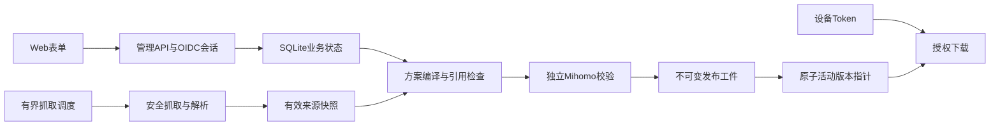

# 架构

本文定义目标技术边界；当前实现及差距见[能力状态](status.md)和[存储决策](adr/0003-initial-slice-storage.md)。产品行为以[设计](design.md)为准，类型范围以[支持矩阵](support-matrix.md)为准。

## 单实例与模块

Go服务提供管理API、设备下载、抓取调度、编译发布和内嵌的TypeScript/React静态资源。运行时不需要Node.js、Redis或外部数据库。SQLite和发布资源使用本地持久磁盘，不以网络共享盘或多副本并发写作为首版运行方式。

模块接口围绕业务边界：来源获取、标准化节点、方案编译、校验、发布、设备授权及身份。避免HTTP处理器直接拼YAML或在下载请求内抓取。调度、发布和清理具备取消、并发上限及一致性保护。

## 状态与恢复

当前开发预览将业务对象、来源缓存和完整自包含发布配置全部保存在加密SQLite记录中；数据库外只保留独立主密钥和校验临时目录。完整首版的独立provider/规则资源尚未实现。加密密钥单独保存，私有权限，不随镜像或数据库升级重建。文件快照中的机密也受加密和权限边界保护，不能只加密数据库字段后把明文副本留在缓存。

发布先完成候选工件、摘要和校验，再提交活动指针；进程中断不得暴露半成品。当前实现以同一SQLite事务提交不可变配置与活动指针，每方案保留最近20版及活动版本。未来引入外部资源时需要另行设计可恢复提交协议。回滚定位不可变发布版本，不重新抓取上游。

备份恢复必须覆盖同一一致性点的数据库、密钥及必要资源，并使用匹配程序。安装和schema升级不得覆盖现有身份、配置或主密钥。当前测试实际复制SQLite备份与对应密钥到新目录恢复；正式一致性备份接口及部署方归档演练仍待完成。

## 新入口

管理页面、管理API和设备下载共用独立子域名，示意基址为 `https://subweft.example.com`。基址由部署配置明确指定，不从未受信的Host或转发头生成。

| 路径 | 契约 |
|---|---|
| `/` | 管理Web UI |
| `/api/v1/...` | 已认证、已授权的管理接口 |
| `/s/<token>/config.yaml` | 稳定设备配置入口 |

当前仅输出自包含配置，不产生远程provider和规则资源URL；完整首版的这类资源URL将由服务生成，绑定设备和发布版本。具体资源路由在API实现时确定，要求可校验、可撤销、防路径穿越、保持发布资源一致性。普通发布和方案切换不改变主订阅URL；客户端刷新主配置后取得新的发布与资源引用。

下载Token不放入管理API或OIDC参数。日志不能记录含Token的完整路径、查询或响应体。Nginx只配置TLS、反代、传输限制及安全日志策略，不保存业务Token、认证映射或生成内容。

## 安全抓取

服务持有上游凭据，因此抓取必须防止SSRF、DNS重绑定、重定向绕过、压缩炸弹和无限解析。每次连接及重定向都校验目标地址。默认拒绝环回、私网、链路本地及元数据地址；确需私网来源时通过明确的管理员允许列表限定。

抓取代理和每来源覆盖属于服务端设置。代理凭据加密，不输出任意上游错误正文。对URL、协议、体积、并发和时间设置上限，不执行用户脚本或任意命令。

## 原生校验

使用已锁定版本、commit和架构摘要的独立Mihomo程序，不直接Go链接其GPL源码。以私有工作目录运行配置测试，限制权限、网络、运行时长和并发，避免读取用户默认目录。固定参数构造，不使用shell拼接，不把任意路径当命令。

校验器可能读取资源或产生文件，因此应为验证提供受控的完整资源集合；未校验的资源不能因主YAML语法通过就宣称有效。输出转成脱敏结构化错误，临时明文及产物按生命周期清理。

Mihomo的GPLv3及其他依赖许可独立审查。若分发二进制，须落实相应许可、来源和对应源码等义务；分进程不是免除许可义务的保证。

## 可观测与资源

提供就绪、版本、来源更新时间、发布结果、任务队列及受限运行状态。抓取成功、发布成功、下载成功与实际连接可用分别表达。健康和指标不暴露节点、Token、URL凭据或用户信息。

性能目标、固定数据场景和容器总峰值的记录要求见[验收标准](acceptance.md)。不以空闲RSS或语法校验代替业务验收。
