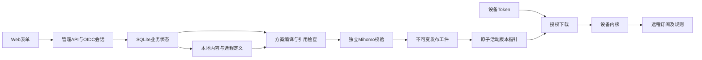

# 架构

本文定义目标技术边界；当前实现及差距见[能力状态](status.md)和[存储决策](adr/0003-initial-slice-storage.md)。产品行为以[设计](design.md)为准，类型范围以[支持矩阵](support-matrix.md)为准。

## 单实例与模块

Go服务提供管理API、设备下载、本地资源维护、编译发布和内嵌的TypeScript/React静态资源。运行时不需要Node.js、Redis或外部数据库。SQLite和发布资源使用本地持久磁盘，不以网络共享盘或多副本并发写作为首版运行方式。

模块接口围绕业务边界：本地节点导入、远程定义、方案编译、校验、发布、设备授权及身份。避免HTTP处理器直接拼YAML或在下载请求内抓取。调度、发布和清理具备取消、并发上限及一致性保护。

## 状态与恢复

业务对象、本地内容、不可变发布及摘要寻址资源全部保存在加密 SQLite；独立主密钥在数据库外。发布固定资源清单并原子切换活动指针，失败保持旧版本，每方案保留最近 20 版及活动版本。见[多资源决策](adr/0005-versioned-resources.md)。

一致性 SQLite 备份包含全部加密状态，恢复到新数据库目录时校验独立密钥与对象解密；部署方另外保护主密钥及锁定程序。升级不得覆盖身份或主密钥。

## 新入口

管理页面、管理API和设备下载共用独立子域名，示意基址为 `https://subweft.example.com`。基址由部署配置明确指定，不从未受信的Host或转发头生成。

| 路径 | 契约 |
|---|---|
| `/` | 管理Web UI |
| `/api/v1/...` | 已认证、已授权的管理接口 |
| `/s/<token>/config.yaml` | 稳定设备配置入口 |

资源路径为 `/s/<token>/releases/<release>/resources/<name>`，绑定设备、同方案的保留发布和精确清单。普通发布保持主入口不变；改绑、过期、暂停、吊销和轮换贯穿所有下载。远程定义直接包含上游 URL 与必要请求头，只有本地版本化资源经服务鉴权下载。吊销无法追回已下发的上游凭据。

下载Token不放入管理API或OIDC参数。日志不能记录含Token的完整路径、查询或响应体。Nginx只配置TLS、反代、传输限制及安全日志策略，不保存业务Token、认证映射或生成内容。

## 设备更新边界

保存、预览、发布、设备下载均不访问远程订阅、规则或地理数据。服务器定时任务仅清理保留范围外的本地资源；旧刷新 API 明确拒绝。OIDC 等身份服务网络访问仍按自身认证配置运行。

订阅请求头加密存储，元数据、预览及错误脱敏。更新出站属于配置引用，不跨配置共享。设备承担 DNS、上游连接及缓存；服务器静态检查出站依赖，但不把它当作网络可达性验证。见 [ADR-0007](adr/0007-device-managed-updates.md)。

## 原生校验

使用已锁定版本、commit和架构摘要的独立Mihomo程序，不直接Go链接其GPL源码。Linux 以 bubblewrap/prlimit 在私有文件和网络命名空间中校验，限制地址空间、CPU、文件大小、描述符、进程、总时长和并发，避免读取用户默认目录。固定参数构造，不使用shell拼接，不把任意路径当命令。

校验器使用独立工作目录。原始字段契约先验证，远程下载定义只在校验投影中替换为受控本地数据；远程地理分类相关条件明确待设备验证。本地上传内容保持完整原生校验，投影不会进入发布工件。结构通过不表示远程内容或连接有效。输出转成脱敏结构化错误，临时明文及产物按生命周期清理。

Mihomo的GPLv3及其他依赖许可独立审查。若分发二进制，须落实相应许可、来源和对应源码等义务；分进程不是免除许可义务的保证。

## 可观测与资源

提供就绪、版本、发布结果、最近设备下载及受限运行状态。结构校验、发布、下载与实际连接可用分别表达，不伪造设备更新反馈。健康和指标不暴露节点、Token、URL凭据或用户信息。

性能目标、固定数据场景和容器总峰值的记录要求见[验收标准](acceptance.md)。不以空闲RSS或语法校验代替业务验收。
